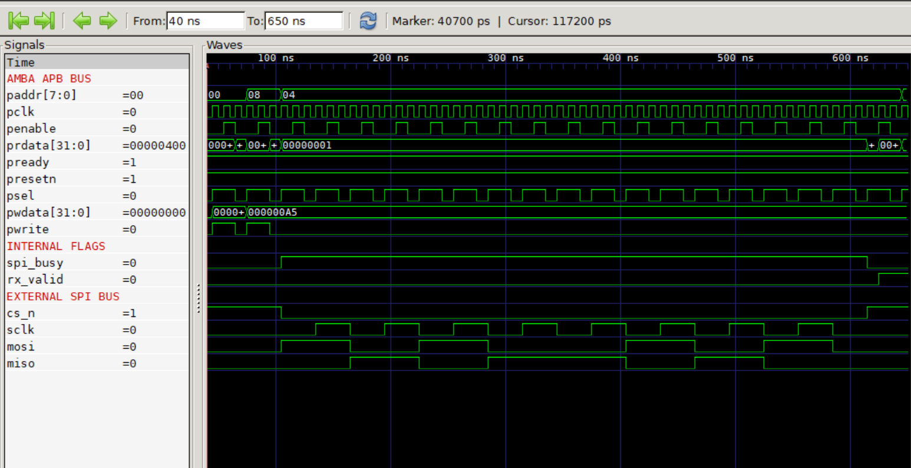

# AMBA APB-to-SPI Bridge

A synthesizable **AMBA APB3-to-SPI Master Bridge** written in Verilog HDL, along with a self-checking Verilog testbench and a **SystemVerilog verification environment** (OOP testbench, SVA protocol assertions, and functional coverage).

I built this project to practice digital RTL design—specifically AMBA bus handshaking, memory-mapped registers, and multi-mode SPI finite state machines—and to apply standard Design Verification (DV) concepts on top of my own design.

---

## Architecture Overview

```text
  AMBA APB3 Bus                 apb_spi_top                  SPI Bus
  -------------          +-----------------------+          ---------
  PCLK / PRESETn ------->|                       |--------> SCLK
  PSEL / PENABLE ------->|  apb_slave            |--------> MOSI
  PWRITE / PADDR ------->|  (Register File)      |<-------- MISO
  PWDATA [31:0]  ------->|         |             |--------> CS_N
  PRDATA [31:0]  <-------|         v             |
  PREADY / PSLVERR <-----|     spi_master        |
                         |    (4-State FSM)      |
                         +-----------------------+
```

The top-level module (`rtl/apb_spi_top.v`) connects two blocks:
1. **`apb_slave` (`rtl/apb_slave.v`):** Implements a zero-wait-state AMBA APB3 slave interface and decodes 32-bit word-aligned register accesses (`paddr[3:0]`).
2. **`spi_master` (`rtl/spi_master.v`):** Implements a 4-state FSM (`STATE_IDLE`, `STATE_LEADING`, `STATE_TRAILING`, `STATE_DONE`) that handles 8-bit full-duplex transfers across all four SPI modes (`CPOL`/`CPHA`).

---

## Register Map

| Offset | Name | Access | Bit Fields | Reset Value | Description |
| :--- | :--- | :--- | :--- | :--- | :--- |
| `0x00` | `CTRL` | R/W | `[0]` `spi_en`<br>`[1]` `cpol`<br>`[2]` `cpha`<br>`[15:8]` `clk_div` | `0x0000_0400` | Enables the SPI core (`spi_en`), selects clock polarity/phase (`Mode 0–3`), and sets the half-period clock divider (`clk_div = 4`). |
| `0x04` | `STATUS` | RO | `[0]` `busy`<br>`[1]` `rx_valid` | `0x0000_0000` | `busy` stays `1` during an active transfer. `rx_valid` goes `1` when a byte completes and clears on an `RX_DATA` read or a new transfer start. |
| `0x08` | `TX_DATA` | R/W | `[7:0]` `tx_data` | `0x0000_0000` | Writing a byte here generates a 1-cycle `spi_start` pulse and starts an 8-bit transfer (when `spi_en == 1` and `busy == 0`). |
| `0x0C` | `RX_DATA` | RO | `[7:0]` `rx_data` | `0x0000_0000` | Holds the 8-bit byte shifted in from `MISO` at the end of the transfer. |

---

## Technical Details & Corner-Case Behavior

### SPI Master (`rtl/spi_master.v`)
* **Bit Order:** MSB-first (`bit 7` is transmitted/sampled first down to `bit 0`).
* **Clock Divider Formula:** Internal counter `clk_cnt` counts from `0` to `clk_div` (`clk_div + 1` cycles of `pclk`) during both `STATE_LEADING` and `STATE_TRAILING`, giving:
  $$f_{\text{SCLK}} = \frac{f_{\text{PCLK}}}{2 \times (\text{clk\_div} + 1)}$$
  At reset (`clk_div = 4`), $f_{\text{SCLK}} = f_{\text{PCLK}} / 10$.
* **Chip Select (`CS_N`) Timing:** Active-low. Asserts (`0`) as soon as `start` is accepted from `STATE_IDLE`, stays low across all 8 bit periods, and holds low for one extra half-period (`clk_div + 1` cycles) in `STATE_DONE` before returning high (`1`).
* **Configuration Updates:** In `STATE_IDLE`, `SCLK` follows `cpol`. Because `cpol`, `cpha`, and `clk_div` feed the SPI core directly without shadow registers, `CTRL` should only be updated when `STATUS.busy == 0`.

### AMBA APB3 Slave (`rtl/apb_slave.v`)
* **Handshake & Error Signals:** `PREADY` is tied high (`1'b1`) for single-cycle `ACCESS` completion (0 wait states), and `PSLVERR` is tied low (`1'b0`).
* **Busy Write Protection:** Writes to `TX_DATA` (`0x08`) while `STATUS.busy == 1` or `CTRL.spi_en == 0` are ignored so ongoing transfers are not corrupted.
* **Read-Only & Unmapped Addresses:** Writes to read-only registers (`STATUS`, `RX_DATA`) or unmapped offsets are ignored; reads from unmapped offsets return `32'h0000_0000`.
* **`rx_valid` Flag Clearing:** `STATUS[1]` (`rx_valid`) is set when `spi_done` pulses and `rx_data_reg` latches `spi_rx_data`. It clears back to `0` when the master reads `RX_DATA` (`0x0C`) or starts a new transfer via `TX_DATA`.

---

## Verification & Simulation Results

### 1. Local Self-Checking Testbench (`tb/tb_apb_spi.v`)
Compiled and simulated locally using **Icarus Verilog (`iverilog`)**. The testbench configures `CTRL`, triggers transfers via `TX_DATA`, polls `STATUS.busy`, reads `RX_DATA`, and checks full-duplex `MOSI`/`MISO` loopback across all four SPI modes:

| Test Case | SPI Mode (`CPOL, CPHA`) | `clk_div` | APB `TX_DATA` | Observed `MOSI` | Slave `MISO` | Read `RX_DATA` | Status |
| :--- | :--- | :--- | :--- | :--- | :--- | :--- | :--- |
| APB Register Read/Write & Polling | All Modes | `2–4` | Verified | Verified | Verified | Verified | **PASS** |
| Full-Duplex Transfer 0 | Mode 0 (`0, 0`) | `2` | `0xA5` | `0xA5` | `0x5A` | `0x5A` | **PASS** |
| Full-Duplex Transfer 1 | Mode 1 (`0, 1`) | `3` | `0x3C` | `0x3C` | `0xC3` | `0xC3` | **PASS** |
| Full-Duplex Transfer 2 | Mode 2 (`1, 0`) | `2` | `0xF0` | `0xF0` | `0x0F` | `0x0F` | **PASS** |
| Full-Duplex Transfer 3 | Mode 3 (`1, 1`) | `4` | `0x96` | `0x96` | `0x69` | `0x69` | **PASS** |

**Simulation Log (`vvp sim.out`):**
```text
======================================================================
 Starting AMBA APB-to-SPI Bridge Functional Tests (Modes 0 to 3)
======================================================================
[PASS] Mode (0,0) | TX=0xa5 -> Slave RX=0xa5 | Slave TX=0x5a -> APB RX=0x5a
[PASS] Mode (0,1) | TX=0x3c -> Slave RX=0x3c | Slave TX=0xc3 -> APB RX=0xc3
[PASS] Mode (1,0) | TX=0xf0 -> Slave RX=0xf0 | Slave TX=0x0f -> APB RX=0x0f
[PASS] Mode (1,1) | TX=0x96 -> Slave RX=0x96 | Slave TX=0x69 -> APB RX=0x69
======================================================================
 RESULT: ALL TESTS PASSED (0 errors)
======================================================================
```

### 2. Simulation Waveform Breakdown (`docs/waveform.png`)
Captured in **GTKWave** (`apb_spi.vcd`), organized into three signal groups showing an APB configuration write, transfer trigger, status polling, and an 8-bit **SPI Mode 0 (`CPOL=0, CPHA=0`)** frame (`40 ns – 650 ns`):



* **AMBA APB Bus (`paddr`, `pclk`, `penable`, `prdata`, `pready`, `presetn`, `psel`, `pwdata`, `pwrite`):** Shows the two-cycle APB `SETUP -> ACCESS` writes to `CTRL` (`0x00`) and `TX_DATA` (`0x08` with `pwdata = 0x000000A5`), followed by `STATUS` (`0x04`) polling returning `prdata = 0x00000001` (`busy = 1`) while the transfer is active *(subsequent `RX_DATA` readback at `0x0C` returning `0x5A` is verified in the simulation log above)*.
* **Internal Flags (`spi_busy`, `rx_valid`):** `spi_busy` asserts (`1`) immediately after `TX_DATA` is written, stays high throughout the 8-bit transfer, and deasserts (`0`) at the end of `STATE_DONE` as `rx_valid` asserts (`1`) to signal received data availability.
* **External SPI Bus (`cs_n`, `sclk`, `mosi`, `miso`):** Active-low `cs_n` frames 8 `SCLK` cycles shifting `0xA5` (`1010_0101`) MSB-first onto `MOSI` while sampling `0x5A` (`0101_1010`) from `MISO`.

### 3. SystemVerilog Verification Environment (`sv/`)
Alongside the Verilog testbench, `sv/` contains an IEEE 1800 SystemVerilog verification setup:
* **Concurrent SVA Assertions (`sv/apb_spi_if.sv`):**
  * `p_setup_to_access`: Checks that `(psel && !penable)` transitions to `(psel && penable)` on the next `pclk` edge.
  * `p_signal_stability`: Checks that `paddr`, `pwrite`, and `pwdata` stay stable from `SETUP` into `ACCESS`.
  * `p_no_unknown_ctrl`: Checks that `{psel, penable, pwrite}` are never `X/Z` when reset is inactive.
* **Layered OOP Testbench (`sv/apb_spi_sv_tb.sv`):**
  * `spi_generator`: Generates 4 directed corner cases (`0x00`, `0xFF`, `0xAA`, `0x55` across Modes `0–3`) followed by 24 constrained-random transactions (`clk_div inside {[1:6]}`).
  * `apb_spi_driver` & `spi_monitor`: Drives APB transfers, models a full-duplex SPI slave BFM, and samples `MOSI` directly from the physical SPI pins.
  * `spi_scoreboard`: Verifies both `MOSI` pin captures and APB `RX_DATA` reads against expected values.
* **Functional Coverage (`cg_spi`):** Defines coverpoints for `cpol`, `cpha`, cross-coverage `cx_spi_mode` (`CPOL x CPHA`), divider bins (`fast = {1,2}`, `mid = {3,4}`, `slow = {5,6}`), and corner payload bins (`0x00`, `0xFF`, `0xAA`/`0x55`).

> **Simulator Note:** `tb/tb_apb_spi.v` runs out-of-the-box with open-source **Icarus Verilog**. Because Icarus Verilog does not support IEEE 1800 constrained-random classes, concurrent SVA properties, or `covergroup` blocks, `sv/apb_spi_if.sv` and `sv/apb_spi_sv_tb.sv` require a full SystemVerilog simulator (such as Questa/ModelSim, VCS, Xcelium, or EDA Playground).

---

## Repository Structure

```text
apb-spi-bridge/
├── docs/
│   └── waveform.png        # GTKWave capture of APB write, status polling, and SPI Mode 0 transfer
├── rtl/
│   ├── spi_master.v        # Synthesizable 4-mode SPI Master FSM
│   ├── apb_slave.v         # AMBA APB3 Slave & memory-mapped registers
│   └── apb_spi_top.v       # Top-level bridge integration
├── tb/
│   └── tb_apb_spi.v        # Self-checking Verilog testbench (Modes 0–3)
├── sv/
│   ├── apb_spi_if.sv       # APB/SPI interfaces + concurrent SVA assertions
│   └── apb_spi_sv_tb.sv    # Layered OOP testbench, scoreboard & covergroup
├── run.bat                 # Windows simulation script (Icarus Verilog)
└── README.md
```

---

## How to Run

### Local Simulation (Windows / Icarus Verilog + GTKWave)
From the repository root, run the batch script:
```cmd
run.bat
```
Or compile, run, and view waveforms manually:
```cmd
iverilog -o sim.out rtl\spi_master.v rtl\apb_slave.v rtl\apb_spi_top.v tb\tb_apb_spi.v
vvp sim.out
gtkwave apb_spi.vcd
```

### SystemVerilog OOP, SVA & Coverage Simulation
Load `rtl/spi_master.v`, `rtl/apb_slave.v`, `rtl/apb_spi_top.v`, `sv/apb_spi_if.sv`, and `sv/apb_spi_sv_tb.sv` into an IEEE 1800-compliant SystemVerilog simulator.